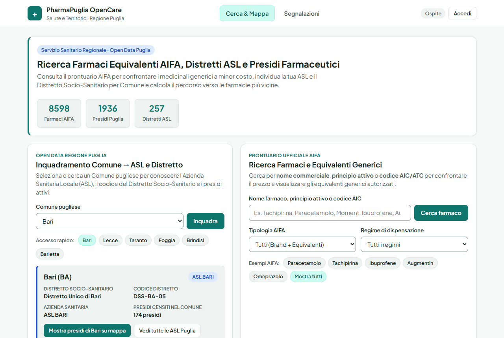
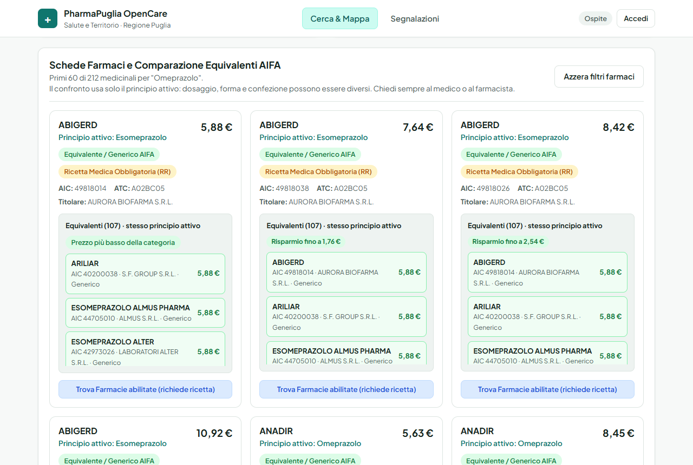
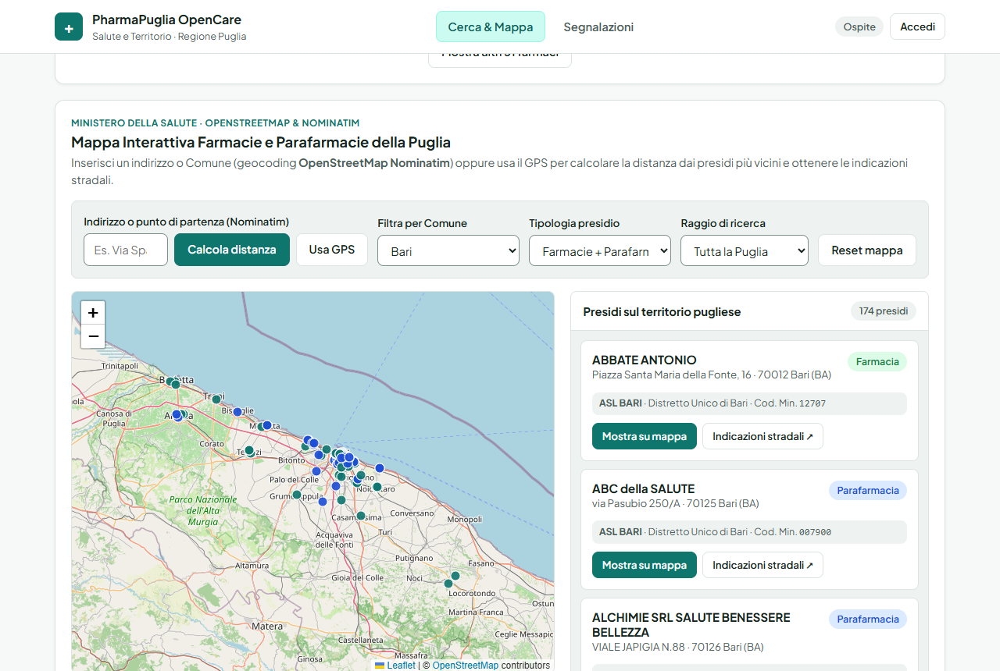
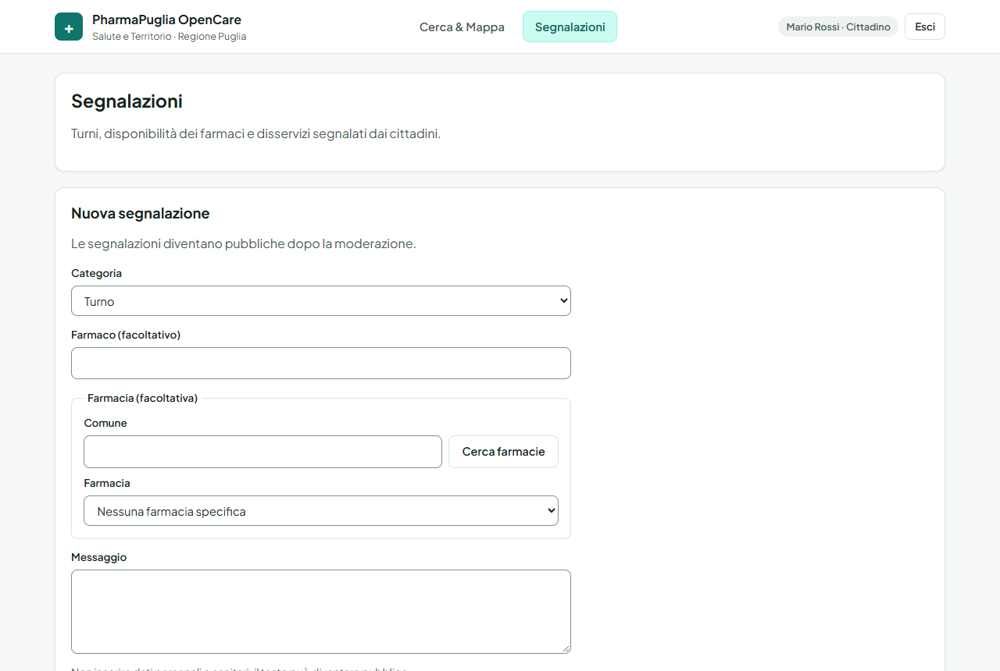
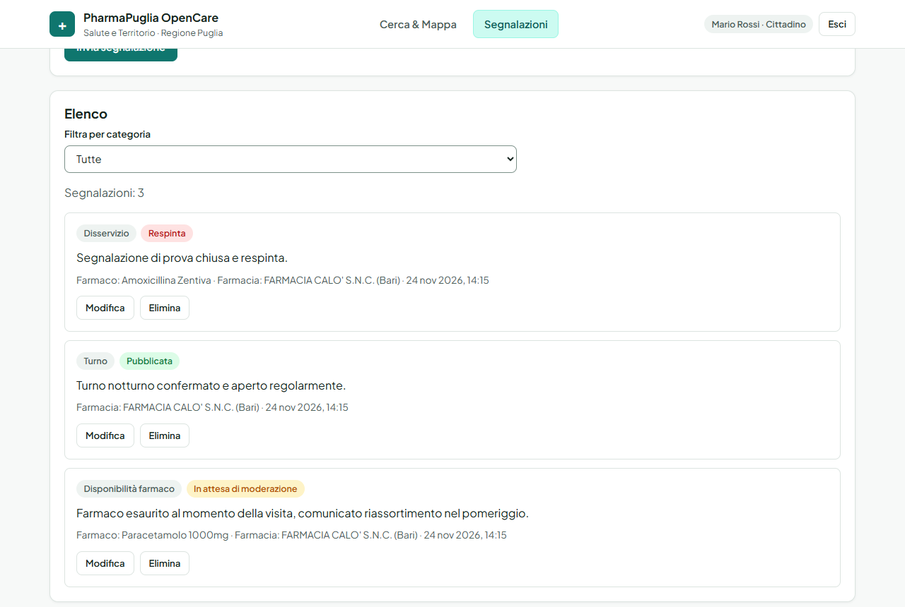
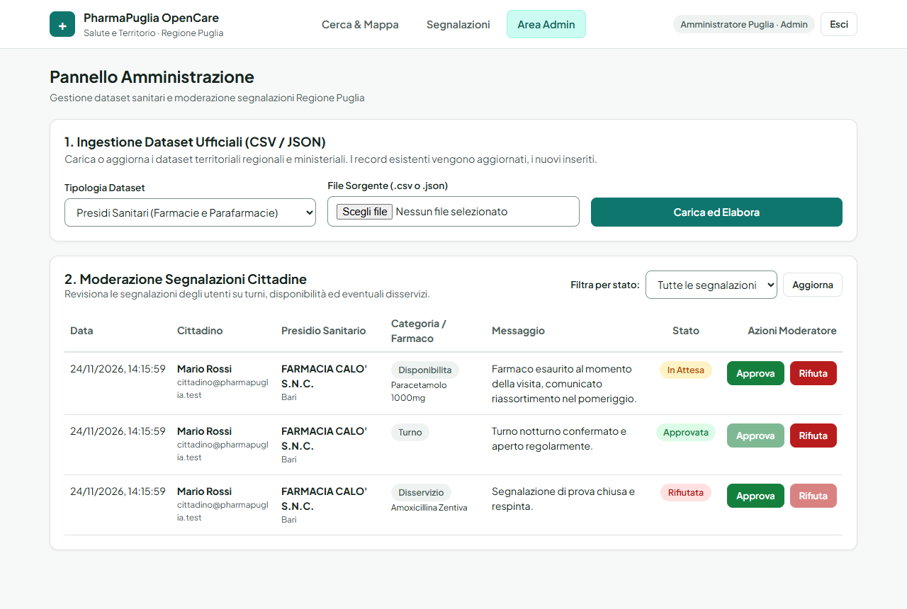

# PharmaPuglia OpenCare

Progetto del gruppo **Tres** per il corso di *Modelli e Metodi per la Qualità del Software* (tema: **Salute e Territorio**).

## 1. Nome e descrizione

**PharmaPuglia OpenCare** è un'applicazione web che riunisce in un solo posto informazioni sanitarie sulla Puglia oggi sparse su portali diversi.

**Il problema.** Chi deve acquistare un farmaco non sa facilmente se esiste un equivalente meno caro, quale farmacia è più vicina e a quale ASL appartiene il proprio comune. Turni, farmaci esauriti e disservizi, inoltre, di solito si scoprono solo arrivando sul posto.

**Chi la usa.**

- **Cittadini**: cercano farmaci ed equivalenti, trovano le farmacie e inviano segnalazioni.
- **Operatori amministratori**: aggiornano i dataset e moderano le segnalazioni prima che diventino pubbliche.

> L'applicazione è un progetto didattico: non sostituisce il parere del medico o del farmacista. Leggi anche i [limiti noti](#9-limiti-noti).

## 2. Gruppo

| Membro | GitHub |
|---|---|
| Dibenedetto Jennifer | [`jenniferdibenedetto`](https://github.com/jenniferdibenedetto) |
| Di Palma Marco | [`DarkFury17`](https://github.com/DarkFury17) |
| Farigu Gabriele Vitocosmo | [`Fariguu`](https://github.com/Fariguu) |

## 3. Dati

| Dati | Fonte | Licenza | Nel progetto |
|---|---|---|---|
| Farmacie | [Ministero della Salute – Farmacie](https://www.dati.salute.gov.it/it/dataset/farmacie/) | [IODL 2.0](https://www.dati.gov.it/iodl/2.0/) | 1.308 farmacie attive in Puglia |
| Parafarmacie | [Ministero della Salute – Parafarmacie](https://www.dati.salute.gov.it/it/dataset/parafarmacie/) | [IODL 2.0](https://www.dati.gov.it/iodl/2.0/) | 628 parafarmacie attive in Puglia |
| Farmaci equivalenti | [AIFA – Liste di trasparenza](https://www.aifa.gov.it/liste-di-trasparenza) (16/11/2026) | [CC BY 4.0](https://creativecommons.org/licenses/by/4.0/deed.it) | 8.598 confezioni |
| Comuni, ASL e distretti | Comuni e province ricavati dai dataset del Ministero; associazione a ASL e distretti **compilata dal gruppo** | – | 257 comuni |
| Mappa e geocoding | [OpenStreetMap](https://www.openstreetmap.org/copyright) e [Nominatim](https://nominatim.org/) | [ODbL 1.0](https://opendatacommons.org/licenses/odbl/) | Servizio online |

Alcune coordinate pubblicate dal Ministero provengono da © OpenStreetMap contributors.

**Come vengono importati**

1. `scripts/prepare_datasets.js` filtra i file originali (solo Puglia, solo presidi attivi), li normalizza e genera i JSON in `data/raw/`. I file originali non sono nel repository, quindi per usare l'app non serve rilanciarlo.
2. `npm run seed` carica i JSON nel database SQLite. È ripetibile: aggiorna i record esistenti senza duplicarli.
3. Un amministratore può poi caricare file CSV o JSON aggiornati dall'Area Admin. In `data/raw/` ci sono tre file `sample_*.csv` per provarlo.

Gli utenti e le segnalazioni di prova sono **inventati** (dominio `.test`). I nomi delle farmacie provengono dagli open data ministeriali.

## 4. Funzionalità

### Ruoli

| Ruolo | Cosa può fare |
|---|---|
| **Ospite** | Cercare farmaci, distretti e farmacie; leggere le segnalazioni approvate |
| **Cittadino** | Come l'ospite, più creare, leggere, modificare ed eliminare le proprie segnalazioni |
| **Admin** | Come il cittadino, più caricare dataset, moderare le segnalazioni e modificare o eliminare quelle che vede |

### Ricerca e mappa

- Ricerca per nome commerciale, principio attivo, codice AIC/ATC o titolare, con elenco degli equivalenti ordinati per prezzo e risparmio possibile.
- Dal comune alla sua ASL e al suo distretto. La ricerca ignora maiuscole, accenti e apostrofi.
- Mappa di farmacie e parafarmacie con filtri per comune, tipo e raggio, distanza da un indirizzo o dalla propria posizione e indicazioni stradali.





### Segnalazioni

- Segnalazioni su turni, disponibilità dei farmaci e disservizi, con farmacia e farmaco facoltativi.
- Ogni segnalazione nasce *in attesa* e diventa pubblica solo se approvata; se l'autore la modifica, torna in attesa.
- I dati dell'autore non sono mai pubblici.




### Area Admin

- Caricamento e validazione di dataset CSV o JSON, con conteggio di record inseriti, aggiornati e scartati.
- Moderazione delle segnalazioni con filtro per stato.



L'interfaccia si adatta anche a [schermi mobili](docs/screenshots/07-mobile.png).

## 5. Architettura

| Livello | Tecnologia |
|---|---|
| Linguaggio | JavaScript (Node.js, CommonJS) |
| Backend | Express |
| Database | SQLite con `better-sqlite3` |
| Autenticazione | JWT (`jsonwebtoken`) e password con `bcryptjs`; ruoli letti dal database |
| Upload | `multer` e `csv-parse` |
| Frontend | HTML, CSS e JavaScript senza framework |
| API esterne | Nominatim (geocoding), tile OpenStreetMap, Leaflet da CDN, Google Fonts |
| Test | `node:test` e `supertest` |

```text
progetto-mmqs/
├── data/
│   ├── raw/            # Dataset puliti e file di esempio
│   └── seed.js         # Caricamento iniziale del database
├── docs/               # Registro del lavoro di gruppo e screenshot
├── progetto/idee/      # Proposte iniziali dei membri
├── public/             # Frontend (index.html, css/, js/)
├── scripts/            # Preparazione dei dataset
├── src/
│   ├── app.js          # Express, intestazioni di sicurezza, gestione errori
│   ├── server.js       # Avvio del server
│   ├── db/             # Connessione e schema SQLite
│   ├── middleware/     # Autenticazione e ruoli
│   └── routes/         # API: auth, reports, search, admin
├── tests/              # Test automatici
├── AGENTS.md           # Istruzioni per i coding agent
└── decisioni.md        # Architettura, contratti API, stile e workflow
```

I contratti completi delle API sono in [`decisioni.md`](decisioni.md).

## 6. Come avviarla

### Requisiti

- [Node.js](https://nodejs.org/) 20 o successivo
- Connessione a internet per mappa, font e geocoding

### Installazione

```bash
git clone https://github.com/mmqs-Tres/progetto-mmqs.git
cd progetto-mmqs
npm install
cp .env.example .env
```

### Variabili d'ambiente

Apri `.env` e imposta almeno le tre variabili obbligatorie:

| Variabile | Obbligatoria | Significato |
|---|---|---|
| `JWT_SECRET` | **Sì** | Segreto casuale di almeno 32 caratteri. Il valore di esempio viene rifiutato |
| `SEED_ADMIN_PASSWORD` | **Sì** | Password dell'admin di prova, a tua scelta (da 8 caratteri a 72 byte) |
| `SEED_CITTADINO_PASSWORD` | **Sì** | Password del cittadino di prova, a tua scelta (da 8 caratteri a 72 byte) |
| `PORT` | No | Porta del server (3000) |
| `DB_PATH` | No | File del database (`./data/pharmapuglia.db`) |
| `JWT_EXPIRES_IN` | No | Durata della sessione (24h) |
| `NOMINATIM_USER_AGENT` | No | Identificativo inviato a Nominatim |

Per generare `JWT_SECRET`:

```bash
node -e "console.log(require('crypto').randomBytes(32).toString('hex'))"
```

### Avvio

```bash
npm run seed
npm start
```

Apri **http://localhost:3000**. Per lo sviluppo, `npm run dev` riavvia il server a ogni modifica.

### Utenti di prova

Sono inventati e vengono creati da `npm run seed`, con le password scelte nel `.env`:

| Ruolo | Email | Password |
|---|---|---|
| Admin | `admin@pharmapuglia.test` | Valore di `SEED_ADMIN_PASSWORD` |
| Cittadino | `cittadino@pharmapuglia.test` | Valore di `SEED_CITTADINO_PASSWORD` |

L'accesso è nel tab **Segnalazioni**; dopo l'accesso come admin compare il tab **Area Admin**. Se cambi le password nel `.env`, rilancia `npm run seed`.

### Test

```bash
npm test
```

Sono 49 test su autenticazione, permessi, segnalazioni, ricerca, seed, upload e gestione degli errori. Non richiedono il file `.env`.

## 7. Sviluppo con i coding agent

### Agent, modelli e approccio

| Membro | Branch / PR | Coding agent | Modello | Approccio |
|---|---|---|---|---|
| Gabriele (`Fariguu`) | `chore/project-setup` (PR #4) | Antigravity | Gemini | Planning guidato con domande preliminari ed esecuzione passo-passo |
| Gabriele (`Fariguu`) | `feat/auth-and-reports` (PR #5) | Claude Code | Claude Opus 5.5 | Plan Mode, analisi delle falle e piano approvato prima dello sviluppo |
| Jennifer (`jenniferdibenedetto`) | `feat/search-map-ui` (PR #6) | Antigravity | Gemini | Plan Mode (`/plan`), sviluppo modulare nel perimetro del branch e verifica automatica |
| Marco (`DarkFury17`) | `feat/data-ingestion-admin` (PR #7) | Antigravity | Gemini 3.8 Flash | Analisi dei dati ministeriali e AIFA, planning in step e sviluppo guidato da test (`node:test`, `supertest`) |
| Gabriele (`Fariguu`) | `fix/integration-polish` (PR #8) | Claude Code | Claude Opus 5.5 | Verifica del `main` integrato, poi correzioni con test e prove nel browser |
| Gabriele (`Fariguu`) | `docs/readme-and-screenshots` | Claude Code | Claude Opus 5.5 | Prova completa su un clone pulito, screenshot e README |
| Gabriele (`Fariguu`) | `docs/readme-and-screenshots` (review in `review-ux/`) | Claude Code | Claude Haiku 5.5 (orchestratore e sette subagent) | Review UX/UI in fasi: prove nell'app a 1280 e 375 px, analisi in parallelo, verifica indipendente di P0 e P1, sintesi in `review-ux/REPORT.md` |

### AGENTS.md

Il repository ha un [`AGENTS.md`](AGENTS.md), letto dagli agent prima di lavorare. Contiene l'obiettivo del progetto, il rimando a `decisioni.md`, le regole obbligatorie (stack, query parametrizzate, nessun segreto nel codice, solo dati inventati, perimetro dei branch, workflow con le PR) e i comandi utili.

### Skill

- **`built-in-browser`**, inclusa in Claude Code desktop (Anthropic): verifica dell'interfaccia nel browser nelle PR #5 e #8.
- Jennifer e Marco non hanno usato skill aggiuntive.

## 8. Lavoro di gruppo

Ogni membro ha lavorato su un proprio branch, con file assegnati per evitare conflitti. Il codice è arrivato su `main` tramite pull request approvate da un altro membro.

| Membro | Contributo principale |
|---|---|
| **Gabriele** | Setup e architettura, autenticazione e ruoli, segnalazioni, integrazione finale, documentazione, review UX/UI dell'app (`review-ux/REPORT.md`) |
| **Jennifer** | API di ricerca, equivalenti, distretti e geocoding; interfaccia e mappa |
| **Marco** | Preparazione dei dataset, seed, upload CSV/JSON, moderazione e dashboard admin |

| PR | Branch | Autore | Contenuto |
|---|---|---|---|
| [#1](https://github.com/mmqs-Tres/progetto-mmqs/pull/1), [#2](https://github.com/mmqs-Tres/progetto-mmqs/pull/2), [#3](https://github.com/mmqs-Tres/progetto-mmqs/pull/3) | `proposta/*` | Tutti | Idee progettuali |
| [#4](https://github.com/mmqs-Tres/progetto-mmqs/pull/4) | `chore/project-setup` | Gabriele | Struttura, schema del database, `AGENTS.md`, `decisioni.md` |
| [#5](https://github.com/mmqs-Tres/progetto-mmqs/pull/5) | `feat/auth-and-reports` | Gabriele | Autenticazione e segnalazioni |
| [#6](https://github.com/mmqs-Tres/progetto-mmqs/pull/6) | `feat/search-map-ui` | Jennifer | Ricerca, mappa e interfaccia |
| [#7](https://github.com/mmqs-Tres/progetto-mmqs/pull/7) | `feat/data-ingestion-admin` | Marco | Dataset, seed e Area Admin |
| [#8](https://github.com/mmqs-Tres/progetto-mmqs/pull/8) | `fix/integration-polish` | Gabriele | Integrazione, stile e correzioni |
| [#9](https://github.com/mmqs-Tres/progetto-mmqs/pull/9) | `docs/readme-and-screenshots` | Gabriele | README di consegna, screenshot e review UX/UI (`review-ux/`) |

Il dettaglio delle attività è in [`docs/lavoro-di-gruppo.md`](docs/lavoro-di-gruppo.md).

## 9. Limiti noti

**Dati**

- **Distretti:** non provengono da un dataset ufficiale. Per 109 comuni su 257 il nome e il codice del distretto sono generati automaticamente e possono essere errati, anche se l'interfaccia riporta "Open Data Regione Puglia".
- **Ricetta:** tutti i farmaci risultano con obbligo di ricetta, perché la lista usata non contiene questa informazione. Il filtro "Senza ricetta" non trova quindi risultati.
- **Farmaci:** sono presenti solo quelli delle liste di trasparenza AIFA. Alcuni esempi dell'interfaccia, come "Tachipirina", non danno risultati.
- **Equivalenti:** il confronto usa solo il principio attivo; dosaggio, forma e confezione possono essere diversi.
- **Codici AIC:** hanno 8 cifre invece di 9, probabilmente per la perdita dello zero iniziale.
- **Posizioni:** 59 presidi su 1.852 con coordinate risultano a oltre 20 km dal centro del proprio comune; altri 84 non hanno coordinate e non compaiono sulla mappa.
- `scripts/prepare_datasets.js` richiede i file originali, non inclusi nel repository.

**Funzioni e sicurezza**

- Nessun limite ai tentativi di accesso, recupero della password o verifica dell'email.
- La sessione resta valida fino alla scadenza del token, conservato nel browser.
- La moderazione non rileva se il testo cambia tra la lettura e l'approvazione.
- Un upload con colonne non riconosciute scarta le righe senza indicarne il motivo; un `district_id` inesistente annulla l'intero caricamento con un errore generico.
- `npm audit` segnala una vulnerabilità di gravità moderata in `csv-parse`, usato solo negli upload degli admin: la correzione richiede una versione incompatibile.
- Ogni ricerca mostra al massimo 60 farmaci e l'elenco delle segnalazioni non è paginato.

**Fuori dall'MVP:** turni ufficiali delle farmacie, disponibilità in tempo reale, notifiche e gestione degli utenti da parte dell'admin.

## Licenza

Il codice è distribuito con licenza [MIT](LICENSE). I dati mantengono le licenze delle rispettive fonti.
